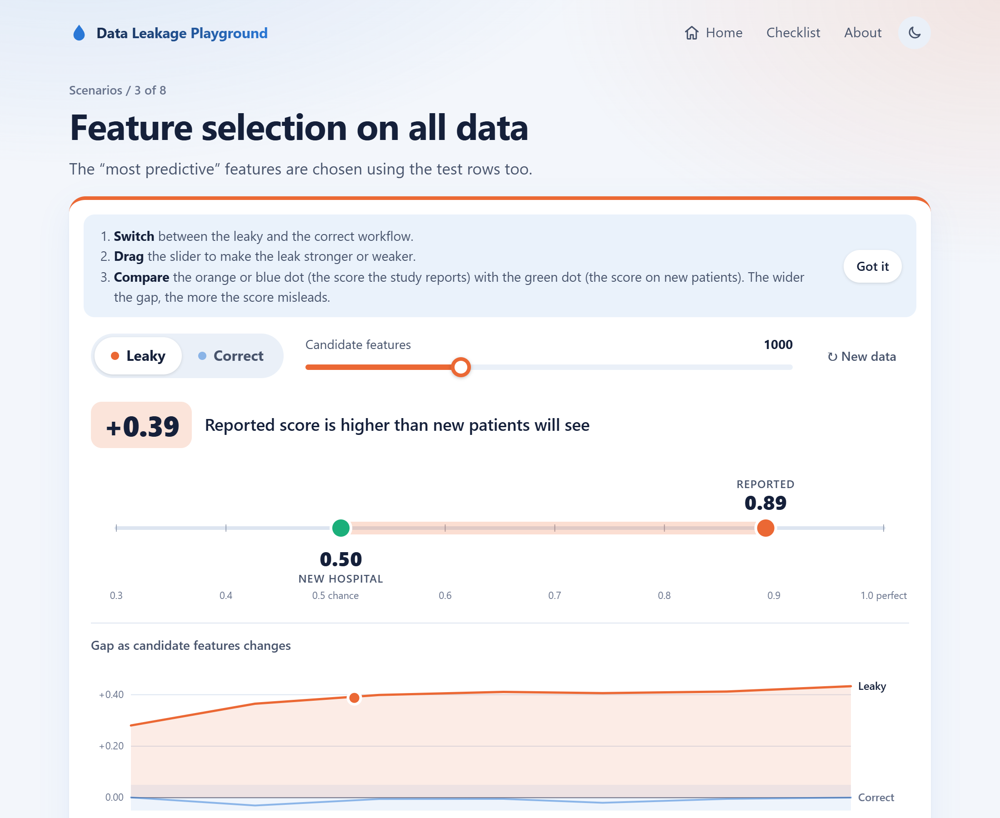

# Data Leakage Playground

**Switch a machine learning leak on and off, watch the reported score inflate, then see what a new hospital would really get.**

**Live demo:** https://01ahsan.github.io/Data-Leakage-Playground/



Data leakage happens when information from the test data slips into training, so a validation score promises more than the model can deliver. This site lets you see eight common forms of it. Each runs a small simulation in your browser, shows the reported score next to the score on an independently generated "new hospital" dataset, and puts the wrong and the right scikit-learn code side by side.

## Features

- **Eight scenarios:** same patient in train and test, preprocessing on all data, feature selection on all data, duplicate records, target leakage, time leakage, tuning on the test set, oversampling before splitting.
- **Leaky / Correct toggle** and a **strength slider** for each scenario (for example, visits per patient or the share of duplicated rows).
- **Three meters:** reported score, new hospital score, and the gap between them (ROC AUC).
- **Gap chart** across the whole slider range, for both workflows, with a data table.
- **Runnable Python** for the wrong and right versions, with copy buttons. Every snippet runs as is with NumPy and scikit-learn.
- **Share links** that encode scenario, mode, strength and seed, and an **embed snippet** (iframe, compact mode) for course pages.
- **Printable checklist** of eight checks.
- **Honest effects.** The simulations are tuned for realistic settings, not for drama. Preprocessing on all data, for example, leaks very little here, and the page says so.
- **Static and private.** No backend, cookies, analytics or external requests. Data is synthetic and generated with a seeded PRNG, so results are identical for everyone.
- Light and dark themes from the system setting, keyboard accessible, readable at 360 px wide.

Default results (seed 42, ROC AUC):

| Scenario                          | Leaky: reported | Leaky: new hospital | Correct: reported | Correct: new hospital |
| --------------------------------- | --------------- | ------------------- | ----------------- | --------------------- |
| 1. Same patient in train and test | 0.91            | 0.73                | 0.76              | 0.73                  |
| 2. Preprocessing on all data      | 0.64            | 0.65                | 0.64              | 0.65                  |
| 3. Feature selection on all data  | 0.89            | 0.50                | 0.51              | 0.50                  |
| 4. Duplicate records              | 0.91            | 0.79                | 0.81              | 0.80                  |
| 5. Target leakage                 | 1.00            | 0.77                | 0.75              | 0.77                  |
| 6. Time leakage                   | 0.87            | 0.75                | 0.76              | 0.75                  |
| 7. Tuning on the test set         | 0.68            | 0.62                | 0.61              | 0.61                  |
| 8. Oversampling before splitting  | 0.99            | 0.84                | 0.81              | 0.84                  |

In correct mode the gap is sampling noise: usually within ±0.05, occasionally up to about ±0.08 for a particular seed and setting.

## Run locally

Requires Node.js 18 or newer.

```sh
npm install
npm run dev        # http://localhost:5173/Data-Leakage-Playground/
npm run check      # lint, type-check and tests
npm run build      # production build in dist/
npm run preview    # serve the production build
```

`npm install` also enables a pre-commit hook (`.githooks/pre-commit`) that runs `npm run check`.

### Screenshots and social preview

The scripts use [Playwright](https://playwright.dev/) with a Chrome or Edge that is already installed, so no browser is downloaded. Set `BROWSER_CHANNEL=chrome|msedge` or `BROWSER_PATH=/path/to/chromium` to choose one.

```sh
npm run build && npm run screenshot   # docs/screenshot.png (+ review shots in scripts/output/)
npm run social                        # docs/social-preview.png from docs/social-preview.svg
```

## How it works

```
src/lib/rng.ts          seeded PRNG (mulberry32) and sampling helpers
src/lib/models/         logistic regression (batch gradient descent, L2) and k-NN (exact k-d tree for ≤ 4 features)
src/lib/metrics.ts      accuracy and ROC AUC
src/lib/split.ts        k-fold, group k-fold and stratified k-fold
src/lib/data/           generators: tabular, patients with repeated visits, drifting time series, pure noise
src/scenarios/          one file per scenario
src/sim/                Web Worker that runs simulations off the main thread
src/pages/              Home, Scenario, Checklist, About
tests/                  Vitest: library, determinism and the leak size for every scenario
```

Cross-validated scores are the mean ROC AUC over folds, as scikit-learn's `cross_val_score` reports them. The **new hospital** score is the final model, trained on all study data, applied to a fresh dataset from the same population (for time leakage, the next period).

## Add a scenario

1. Create `src/scenarios/09-your-leak.ts` and export `defineScenario({...})` with:
   - `id`, `number`, `title`, `oneLiner`, `medicalExample`, `explanation` (plain language, under 120 words), `setup`
   - `strength`: `label`, `min`, `max`, `step`, `default`, `hint`, optional `format`
   - `evaluate({ leaky, strength, seed })` returning `{ reportedScore, newHospitalScore }`. It must be deterministic: derive every random stream from the seed with `stream(seed, SALT.data)`, `stream(seed, SALT.split)` and so on.
   - `wrongCode` and `rightCode`: short Python that runs as is with scikit-learn.
2. Add it to the list in `src/scenarios/index.ts`. `run()` and the gap curve are added by `defineScenario`.
3. Run `npm test`. The shared tests check determinism, that the leaky gap at default settings is above 0.05, that the correct gap stays under 0.05, metadata, and speed. If the honest effect is small, add the id to `SMALL_EFFECT` in `tests/scenarios.test.ts` and say so in the explanation.
4. Keep one evaluation under about 200 ms in the browser (the curve is computed in the background).
5. Check that both Python snippets run and that the numbers point the same way as the simulation.

## Licence and credits

- Code: [MIT](LICENSE).
- Written content (explanations, checklist, this README): [CC BY 4.0](https://creativecommons.org/licenses/by/4.0/).
- The scenarios follow the leakage taxonomy of Kapoor and Narayanan, _Leakage and the reproducibility crisis in machine-learning-based science_ (Patterns, 2023), and the REFORMS checklist (Kapoor et al., Science Advances, 2024). See [reproducible.cs.princeton.edu](https://reproducible.cs.princeton.edu/). This project is independent and not affiliated with Princeton.
- All data is synthetic. Medical examples are illustrations only.
